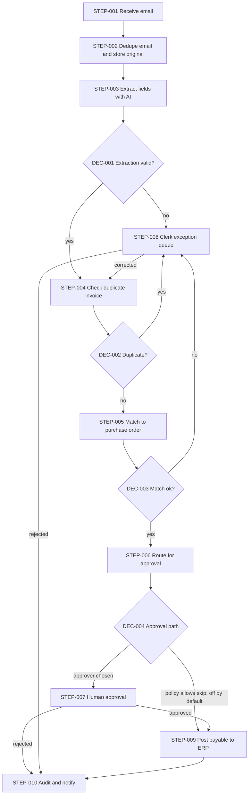
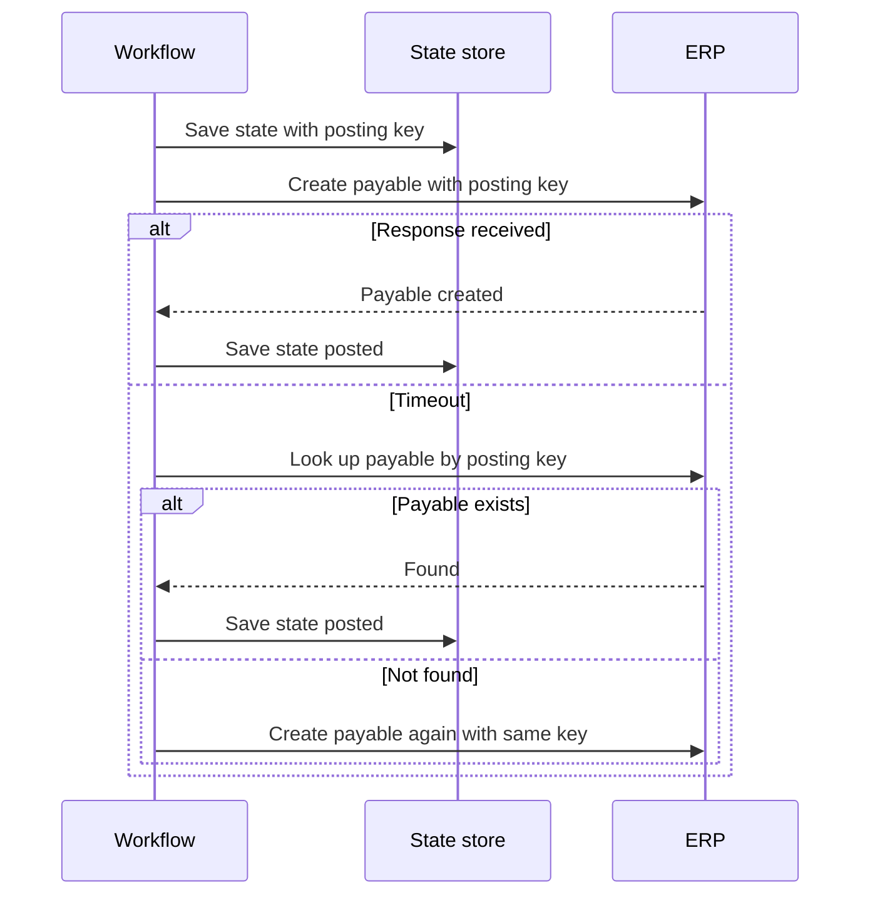

> Chain: stage=3 | skill=ai-workflow-architect | upstream=01-requirements.md, 02-architecture.md | next=none

Depth: full

# Workflow Architecture: Supplier Invoice Intake and Approval (chain example)

## Executive Summary

Invoices arrive by email as PDFs and are re-keyed by hand. The recommended design uses one AI step to read the invoice, then fixed rules for duplicate check, purchase-order match and routing. A person approves every payment by default, and the ERP gateway refuses to post anything without a stored human decision. No agent is used. The conflict between "nobody looks at small invoices" and "a person always approves" (CONFLICT-001) is not resolved here; the design defaults to the safe side and makes the other side a setting.

## Business Objective

| Objective in this workflow | Upstream objective | Evidence |
|---|---|---|
| Read, check and route supplier invoices with less re-keying, no duplicate or unapproved payment, and a full record | BO-001, BO-002, BO-003 | `[DOCUMENTED]` 01-requirements.md |

## Actors

| Actor | Role |
|---|---|
| AP clerk | Resolves exceptions `[STATED]` (ACT-001) |
| AP manager | Approves above the first threshold `[STATED]` (ACT-002) |
| Controller | Approves above the second threshold `[STATED]` (ACT-003) |
| Supplier | Sends invoices by email; no system access `[ASSUMED]` (A-004) |
| ERP | System of record for orders and payables (vendor `NOT PROVIDED`) |

## Constraints

The ERP stays (CON-001). ERP API capabilities are `REQUIRES VALIDATION` (Q-004). Thresholds, volume, retention and hosting are `NOT PROVIDED` (Q-001, Q-002, Q-007, Q-008).

## Carried forward from upstream

| Upstream | Status in this document |
|---|---|
| A-001 to A-007 | Still assumed; none contradicted. A-003 (email notices) drives TOOL-006. A-005 (ERP is source of truth) drives TOOL-002. |
| Q-001, Q-002, Q-004, Q-005, Q-006, Q-007, Q-008, Q-009, Q-010 | Still open; each is cited where a design choice depends on it. |
| Q-003 | Open and blocking: DEC-004 and WADR-003 are built so either answer fits. |

## Assumptions

| ID | Assumption | Impact if wrong |
|---|---|---|
| A-008 | Under the default policy, invoices at or below the first threshold are approved by someone with AP approval rights; who is not stated `[ASSUMED]` | If a clerk may approve, separation-of-duties (Q-009) must be settled |
| A-009 | The ERP can look up a payable by an external reference `[ASSUMED]`, `REQUIRES VALIDATION` | If not, our registry is the only duplicate guard and a daily reconciliation against the ERP is needed (WRISK-002) |
| A-010 | A rejected invoice is recorded and the clerk informs the supplier outside the system `[ASSUMED]` | Supplier messaging becomes new scope |

## Requirements

| ID | Description | Source | Priority | Acceptance criteria |
|---|---|---|---|---|
| WR-001 | Each emailed invoice file creates exactly one invoice record, even if delivered twice | `[DOCUMENTED]` FR-001 | Must | AC-001-1, AC-001-2 |
| WR-002 | Extract fields with confidence; unreadable or low-confidence results go to the clerk queue | `[DOCUMENTED]` FR-002, AIR-001 | Must | AC-002-1, AC-002-2 |
| WR-003 | Match each invoice to its purchase order and report differences | `[DOCUMENTED]` FR-003 | Must | AC-003-1, AC-003-2 |
| WR-004 | A supplier and invoice number is posted at most once | `[DOCUMENTED]` FR-004, BR-003 | Must | AC-004-1, AC-007-2 |
| WR-005 | Select the approver by invoice total | `[DOCUMENTED]` FR-005, BR-002 | Must | AC-005-1, AC-005-2 |
| WR-006 | No post to the ERP without a recorded decision by a person; the AI never approves or pays | `[DOCUMENTED]` BR-001, FR-006 | Must | AC-006-1 |
| WR-007 | Post the approved invoice once and store the ERP reference | `[DOCUMENTED]` FR-007, IR-002 | Must | AC-007-1, AC-007-2 |
| WR-008 | Clerk queue with correction and re-entry | `[DOCUMENTED]` FR-008 | Must | AC-008-1 |
| WR-009 | Record every state change, decision and post | `[DOCUMENTED]` FR-009, NFR-004 | Must | AC-009-1 |
| WR-010 | Remind and escalate approvals that wait too long | `[DOCUMENTED]` FR-010 | Should | AC-010-1 |
| WR-011 | The small-invoice policy is a setting whose default is human approval for all | `[RECOMMENDED]` ADR-006, BR-004 | Must | Setting off: no post without a decision. Setting on: requires named owner sign-off (Q-003). |

The status and ageing report (FR-011) is a user-interface screen, not a workflow step; see TASK-008. Priority changes: none.

## Workflow Drivers

| ID | Driver | Why it matters | Options it eliminates |
|---|---|---|---|
| WD-001 | Payment control: no unapproved and no duplicate payment (BR-001, BR-003) | Money leaves the company | Fully automatic posting |
| WD-002 | Auditability (FR-009) | Finance control | Designs where decisions are not stored |
| WD-003 | Supplier invoice layouts vary `[ASSUMED]` | Fixed templates break on a new supplier | Pure template extraction |
| WD-004 | Volume unknown (Q-001) | Nothing can be sized | Queue clusters, workflow engines, separate services |
| WD-005 | ERP capabilities unknown (Q-004) | Posting safety depends on them | A design that assumes the ERP rejects repeats |

## Quality Attributes

Payment control and auditability are testable now (TEST-003, TEST-007). Speed and accuracy: target not defined (Q-005), so no test passes or fails on them yet; TEST-002 measures and reports. Security: access roles, untrusted input and secret handling are designed (section Security); NFR-001 has no measurable target. Availability: no requirement exists, so none is designed.

## Trigger Architecture

Source: a new message in the shared AP mailbox (INT-001; provider `NOT PROVIDED`). Payload: email with attachments. Authentication: delegated read-only mailbox access, credentials in a secret store. Validation: PDF type and size limit; non-invoice mail is ignored. Volume: `UNKNOWN` (Q-001). Duplicate behavior: message ID plus file hash (WR-001). Failure behavior: mailbox outage raises an alert and polling resumes; nothing is lost because unread mail stays in the mailbox.

## Alternatives

| | A. Templates and OCR rules | B. AI extraction plus fixed rules, people approve | C. Agent chooses the steps | D. Buy an invoice-automation product |
|---|---|---|---|---|
| Complexity | Low at first, grows per supplier | Medium | High | Low to run, unknown to fit |
| Reliability | High on known layouts | High with validation and fallback | Variable path | Vendor dependent |
| Cost | Low run cost, high upkeep | Model use per invoice (not computed) | Highest | Licence `NOT PROVIDED` |
| Maintainability | Template sprawl | Prompt and schema | Prompt, tools, permissions | Vendor roadmap |
| Security | Simple | Invoice text goes to a model | Widest surface | Vendor handling `REQUIRES VALIDATION` |
| Fits when | Few suppliers, fixed formats | Many layouts, fixed process | Open-ended process | A product covers BR-001 and WR-004 natively |

## Trade-offs

B accepts model use and sending invoice text to a model (Q-010, WRISK-006) in exchange for not maintaining templates (WD-003). A is cheaper to run but conflicts with WD-003 if suppliers are many. C adds nothing the fixed process needs. D could win if one product proves to meet BR-001 and the ERP (OPT-B); that is a product search, not done here.

## Selected Architecture

Option B inside the modular monolith chosen upstream (ADR-001). Orchestration is a state machine in the application database (WADR-002). `[RECOMMENDED]`

## Workflow Architecture

**DEC-001** Extraction valid? Method: rule. Schema check, line sum equals total, date and currency formats, required fields present. Fallback: clerk queue.

**DEC-002** Duplicate? Method: rule. Same supplier and invoice number already in the registry or found in the ERP (A-009). A duplicate is never posted; a clerk confirms or rejects. Fallback: clerk queue.

**DEC-003** Match ok? Method: rule. PO exists and amounts agree within a tolerance `NOT PROVIDED` (Q-002). Fallback: clerk queue.

**DEC-004** Approval path. Method: rule plus human. Total above the second threshold: Controller. Above the first: AP manager. At or below the first: approver per Q-012 (A-008). The skip branch exists only if the policy setting (WR-011) is turned on with owner sign-off; it is off by default. Fallback: clerk queue if no approver can be found.

Step table. Retry counts and timeouts are `[RECOMMENDED]` starting values, to be tuned once volume and ERP limits are known.

| Step ID | Name | Type | Input | Output | Failure | Retry | Timeout | Effect |
|---|---|---|---|---|---|---|---|---|
| STEP-001 | Receive email | Trigger | Mailbox poll | Message with attachments | Mailbox unavailable: alert, polling resumes; mail stays unread | Backoff with jitter | 30 s | Read-only |
| STEP-002 | Dedupe email and store original | Storage | Message ID, file hash | Stored original or "duplicate" | Fail closed: do not process, alert | 3 attempts | 10 s | Reversible |
| STEP-003 | Extract fields with AI | AI call | PDF text and images | Schema-checked fields with confidence | Invalid output: one repair retry, then STEP-008 | 1 repair retry; 2 on transient API error | 60 s | Read-only |
| STEP-004 | Check duplicate invoice | Rule + lookup | Supplier, invoice number | Duplicate or new | Lookup failure: retry, then STEP-008 | 3 attempts, backoff | 15 s | Read-only |
| STEP-005 | Match to purchase order | API call (ERP) | PO reference, supplier, amounts | Matched or differences | Lookup failure: retry, then STEP-008 | 3 attempts, backoff | 15 s | Read-only |
| STEP-006 | Route for approval | Rule | Invoice total, thresholds | Approver or policy result | Thresholds missing: hold and alert, never skip approval | None | 5 s | Reversible |
| STEP-007 | Human approval | Human approval | Invoice, original PDF, extracted values, match result | Approve or reject with reason | No answer: reminder, then escalate to backup approver (Q-006); never auto-approve | One reminder at half the wait limit | `NOT PROVIDED` wait limit (Q-006); reminder then escalation | Reversible |
| STEP-008 | Clerk exception queue | Human approval | Item with failure context | Corrected item or rejection | Queue unavailable: alert, hold the item | 3 attempts | `NOT PROVIDED` wait limit (Q-011); ageing alert, then manager notice | Reversible |
| STEP-009 | Post payable to ERP | API call (ERP) | Approved invoice, posting key | ERP reference | Unknown outcome: look up by posting key before any retry (ADR-004) | Transient errors only, same key | 30 s | Irreversible |
| STEP-010 | Audit and notify | Storage | Event | Audit row, notices | Audit failure: alert and block the next state change | 5 attempts | 10 s | Reversible |

## Decision Architecture

Decisions are DEC-001 to DEC-004 above. Only DEC-004's last branch involves a person's judgement; the rest are rules. No decision uses the AI.

## AI Architecture

One AI step (STEP-003, TOOL-005). Input is the invoice content only. Output is typed JSON with a confidence value per field. Deterministic checks follow in DEC-001. The model has no tools, no ERP access and no way to approve (BR-001, ADR-003). Invoice text is untrusted: instructions inside it are data (WRISK-001). Model class: chosen by measured accuracy on a labelled sample, `REQUIRES VALIDATION`; hosted or local is open (Q-010). Time-sensitive: no model name is fixed here. Low-confidence cut-off: `NOT PROVIDED` (Q-005).

## Agent Architecture

Not applicable: the path is known in advance, so a fixed pipeline meets every requirement (rung 2 of the complexity ladder).

## Tool Architecture

| Tool ID | Purpose | Input / Output | Permission | Idempotent | Failure | Status |
|---|---|---|---|---|---|---|
| TOOL-001 | Read new mail and attachments (INT-001) | Mailbox query / messages | Read-only | Yes | Retry, alert | `REQUIRES VALIDATION` |
| TOOL-002 | Look up PO and receipt (INT-002) | PO reference / PO data | Read-only | Yes | Retry, then queue | `REQUIRES VALIDATION` |
| TOOL-003 | Create payable (INT-002) | Invoice, posting key / ERP reference | Create payable only | Only with posting key and prior lookup | Look up before retry | `REQUIRES VALIDATION` |
| TOOL-004 | Find payable by reference (INT-002) | Posting key / payable or none | Read-only | Yes | Retry | `REQUIRES VALIDATION` |
| TOOL-005 | Read invoice with model | Document / typed fields | No side effects | Yes | One repair retry | `REQUIRES VALIDATION` |
| TOOL-006 | Send email notice (A-003) | Recipient, text / sent flag | Send to staff only | Yes with message key | Retry, then queue | `REQUIRES VALIDATION` |

## MCP Architecture

Not applicable: no requirement calls for MCP; plain connectors are enough.

## Data Flow

Email attachment → stored original (access controlled) → extracted fields → registry record → ERP lookups (read-only) → approval record → ERP payable → audit record. Sensitive: supplier bank details and amounts. Only the document content needed for extraction goes to the model, and bank details are not an extraction field unless a requirement adds them.

## State Management

Each invoice has one state: received, extracted, in-exception, matched, awaiting-approval, approved, rejected, posted. State and the posting key are saved before STEP-009 so a restart resumes safely (WADR-002). State changes and audit rows are written together.

## Human-in-the-Loop

Two human steps: STEP-007 (approval) and STEP-008 (exceptions). Each screen shows the original PDF beside the extracted values, so a person is not asked to trust the AI's reading (WRISK-005). A slow or absent approver leads to reminder, then escalation, never to approval (WADR-003). A rejection ends the flow with a recorded reason (A-010).

## Error Handling

Per-step failure, retry and timeout are in the step table. Categories: input (unreadable or non-invoice file → STEP-008, no retry); tool/API (mailbox or ERP outage → retry transient errors, alert on permanent ones); AI (invalid output → one repair retry, then STEP-008); business (duplicate or mismatch → explicit branch to STEP-008); policy (missing thresholds → hold, never skip approval).

## Retry & Recovery

Retry only transient failures, with backoff and jitter, as listed per step. STEP-009 is the only irreversible step. It runs last, after validation and approval, with a posting key derived from supplier and invoice number (WR-004). After a timeout the workflow looks up the payable by that key before any retry, so a retry cannot create a second payable (AC-007-2). If the ERP cannot look up by key (A-009), posting is held until a person confirms, and the daily reconciliation catches strays (WRISK-002). A crash between approval and posting resumes from saved state.

## Security

Roles: clerk, AP manager, Controller; a clerk cannot approve (ADR-002 enforces at the gateway). Mailbox and ERP credentials sit in a secret store, least privilege (create payable only). Approvers sign in through the company identity provider (Q-007). Originals are access controlled; retention `NOT PROVIDED` (Q-008). AI-specific: injected text, malicious files and data sent to a model are handled by file-type limits, no model tools, schema-only output, and a provider decision (Q-010). Audit records are append-only (ADR-005).

## Observability

Correlation ID per invoice from message ID. Metrics: invoices received and posted, exception rate by cause, extraction validity rate, approval wait time, duplicates caught, ERP post failures. Alerts, each with an owner: mailbox silence, queue ageing, approval wait past limit (Q-006), stuck state, audit-write failure, post failure. Alert limits `NOT PROVIDED`.

## Scalability

Volume is `UNKNOWN` (Q-001), so no queue, cluster or workflow engine is added. `RECOMMENDED`: build the single deployable unit now. First change if volume or ERP rate limits bite: bounded concurrency on STEP-003 and STEP-005.

## Cost

| Item | Basis | Evidence |
|---|---|---|
| Invoices per month | `NOT PROVIDED` | Q-001 |
| Model use per invoice | volume × content size × provider price; not computed | provider price `REQUIRES VALIDATION` |
| ERP calls | per-invoice calls in STEP-004, STEP-005, STEP-009; limits `REQUIRES VALIDATION` | Q-004 |
| Clerk time on exceptions | exception rate × time per exception | `UNKNOWN`; likely the larger cost |

## ADRs

**WADR-001** Use AI only to read the invoice; matching, routing and approval stay rule-based or human. Context: WD-001, WD-003. Options: A, B, C, D. Selected: B. Advantages: handles layout variety, money decisions stay deterministic. Disadvantages: invoice text reaches a model (Q-010). Classification: `RECOMMENDED`.

**WADR-002** Orchestrate with a state machine in the application database, no separate workflow engine. Context: WD-004, ADR-001. Options: engine, queue plus workers, state machine. Selected: state machine. Disadvantages: custom code for waits and reminders. Classification: `RECOMMENDED`.

**WADR-003** A waiting approval escalates and never auto-approves; the small-invoice skip is a setting off by default. Context: BR-001, BR-004, CONFLICT-001, ADR-006. Selected: both safeguards. Disadvantages: more human work until Q-003 is answered. Classification: `REQUIRED`.

## Risks

| ID | Risk | Likelihood | Severity | Mitigation |
|---|---|---|---|---|
| WRISK-001 | Injected text in an invoice steers the model | `UNKNOWN` | High | No tools, schema-only output, DEC-001 checks, TEST-005 |
| WRISK-002 | Duplicate payable if the ERP cannot detect a repeat | `UNKNOWN` | High | Posting key, lookup first, daily reconciliation, hold if no lookup (Q-004) |
| WRISK-003 | Approval stalls and invoices age | `UNKNOWN` | Medium | Reminder, escalation, ageing alerts once limits exist (Q-006) |
| WRISK-004 | Unapproved payment if the skip setting is turned on carelessly | `UNKNOWN` | High | Off by default, owner sign-off, audit of the setting (Q-003) |
| WRISK-005 | A person approves a misread amount | `UNKNOWN` | High | Original beside extracted values, DEC-001 sum check |
| WRISK-006 | Supplier data sent to an external provider | `UNKNOWN` | Medium | Decide provider and terms before build (Q-010) |

## Implementation Blueprint

| Task | Component | Objective | Depends on | Acceptance criteria |
|---|---|---|---|---|
| TASK-001 | Mailbox intake and dedupe (STEP-001, STEP-002) | One record per file | none | WR-001 |
| TASK-002 | Extraction and checks (STEP-003, DEC-001) | Typed fields with confidence | TASK-001 | WR-002 |
| TASK-003 | Duplicate check and PO match (STEP-004, STEP-005, DEC-002, DEC-003) | Flag duplicates and mismatches | TASK-002 | WR-003, WR-004 |
| TASK-004 | Routing and approval (STEP-006, STEP-007, DEC-004) | Right approver, recorded decision, escalation | TASK-003 | WR-005, WR-006, WR-010, WR-011 |
| TASK-005 | Exception queue (STEP-008) | Correct and re-enter | TASK-003 | WR-008 |
| TASK-006 | ERP gateway and posting (STEP-009) | Idempotent post, approval check | TASK-004 | WR-006, WR-007 |
| TASK-007 | Audit and notices (STEP-010) | Append-only record | TASK-001 | WR-009 |
| TASK-008 | Review UI and status report | Approval and queue screens, FR-011 report | TASK-004, TASK-005 | WR-008, FR-011 |

## Testing Strategy

| Test | Type | Scenario | Verifies |
|---|---|---|---|
| TEST-001 | Unit | Sum, date and currency checks including bad input | TASK-002 |
| TEST-002 | AI | Labelled invoice sample; report accuracy and invalid-output rate (targets from Q-005) | TASK-002 |
| TEST-003 | Workflow | Happy path through approval to post, each approver tier | TASK-003, TASK-004, TASK-006 |
| TEST-004 | Failure | ERP times out during post; retry yields one payable | TASK-006 |
| TEST-005 | Security | Invoice with injected instructions; wrong file type | TASK-001, TASK-002 |
| TEST-006 | Human approval | Approve, reject, no answer, escalation, never auto-approve | TASK-004 |
| TEST-007 | Control | Attempt to post with no recorded decision is refused at the gateway | TASK-006 |
| TEST-008 | Duplicate | Same email twice; same invoice number resent | TASK-001, TASK-003 |
| TEST-009 | Recovery | Crash between approval and post | TASK-006 |
| TEST-010 | Policy | Skip setting off and on; on requires sign-off | TASK-004 |

## Traceability

| WR | WD | STEP | TOOL | TASK | TEST |
|---|---|---|---|---|---|
| WR-001 | WD-004 | STEP-001, STEP-002 | TOOL-001 | TASK-001 | TEST-008 |
| WR-002 | WD-003 | STEP-003, STEP-008 | TOOL-005 | TASK-002 | TEST-001, TEST-002, TEST-005 |
| WR-003 | WD-001 | STEP-005 | TOOL-002 | TASK-003 | TEST-003 |
| WR-004 | WD-001 | STEP-004, STEP-009 | TOOL-004 | TASK-003, TASK-006 | TEST-004, TEST-008 |
| WR-005 | WD-001 | STEP-006 | TOOL-006 | TASK-004 | TEST-003 |
| WR-006 | WD-001 | STEP-007, STEP-009 | TOOL-003 | TASK-004, TASK-006 | TEST-006, TEST-007 |
| WR-007 | WD-005 | STEP-009 | TOOL-003, TOOL-004 | TASK-006 | TEST-004, TEST-009 |
| WR-008 | WD-002 | STEP-008 | TOOL-006 | TASK-005, TASK-008 | TEST-003 |
| WR-009 | WD-002 | STEP-010 | TOOL-006 | TASK-007 | TEST-003 |
| WR-010 | WD-001 | STEP-007 | TOOL-006 | TASK-004 | TEST-006 |
| WR-011 | WD-001 | STEP-006 | TOOL-006 | TASK-004 | TEST-010 |

## Upstream Coverage

| Upstream item | Handled by |
|---|---|
| FR-001 to FR-010 | WR-001 to WR-010, see Traceability |
| FR-011 | Not a workflow concern: a screen, TASK-008 |
| NFR-001 | Section Security; no measurable target upstream |
| NFR-002, NFR-003 | No target defined (Q-005); measured in TEST-002 |
| NFR-004 | WR-009, STEP-010; retention open (Q-008) |
| BR-001 | WR-006, WADR-003, TEST-007 |
| BR-002 | WR-005, DEC-004 |
| BR-003 | WR-004, STEP-004, STEP-009 |
| BR-004 | WR-011, WADR-003; unresolved (Q-003) |
| AIR-001 | STEP-003, section AI Architecture |
| IR-001 | TOOL-001, STEP-001 |
| IR-002 | TOOL-002, TOOL-003, TOOL-004 |
| CON-001 | Constraints; ERP stays |
| DEP-001 | Access to ERP and mailbox; Trigger Architecture, Security |
| AC-001-1, AC-001-2 | WR-001, TEST-008 |
| AC-002-1, AC-002-2 | WR-002, TEST-001 |
| AC-003-1, AC-003-2 | WR-003, TEST-003 |
| AC-004-1 | WR-004, TEST-008 |
| AC-005-1, AC-005-2 | WR-005, TEST-003 |
| AC-006-1 | WR-006, TEST-007 |
| AC-007-1, AC-007-2 | WR-007, TEST-004 |
| AC-008-1 | WR-008, TEST-003 |
| AC-009-1 | WR-009, TEST-003 |
| AC-010-1 | WR-010, TEST-006 |
| AC-011-1 | TASK-008 |
| ADR-001 | Selected Architecture, WADR-002 |
| ADR-002 | WR-006, TASK-006, TEST-007 |
| ADR-003 | AI Architecture, WRISK-001 |
| ADR-004 | Retry & Recovery, STEP-009 |
| ADR-005 | Security, STEP-010 |
| ADR-006 | WR-011, WADR-003 |
| INT-001 | TOOL-001 |
| INT-002 | TOOL-002, TOOL-003, TOOL-004 |
| COMP-001 to COMP-013 | Steps and tools above; COMP-007 is TASK-008, COMP-010 is STEP-010 |

## Diagrams

The workflow diagram is under Workflow Architecture. The sequence below shows why a timeout at STEP-009 never creates a second payable.

## Validation

Checked with the plugin's scripts at depth full: `validate_workflow.py --strict`, `validate_ids.py`, `validate_diagrams.py` and `validate_chain.py --strict` (run by `ci-smoke.sh`). Not validated, because outside the document: ERP API capabilities, mailbox access, model provider terms, all thresholds and volumes.

## Open Questions

| ID | Question | Why it matters |
|---|---|---|
| Q-011 | How long may an invoice wait in the clerk queue before escalation? | Gives STEP-008 a real wait limit |
| Q-012 | Who approves invoices at or below the first threshold if BR-001 applies to all? | DEC-004 last branch (A-008) |
| Q-013 | What happens to a rejected invoice: is the supplier told, by whom? | STEP-010 and A-010 |
